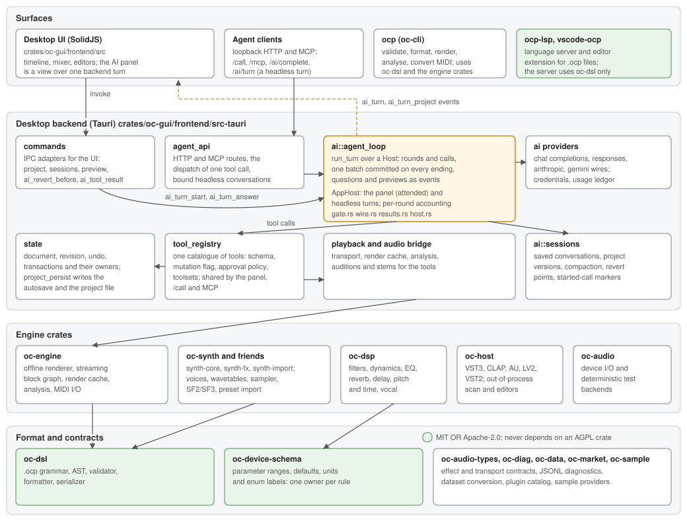

# OpenCompose manual

OpenCompose is a digital audio workstation whose project is a text file. A song
is a `.ocp` document: tracks, patterns, notes, mixer settings and effects written
as readable lines instead of stored as an opaque session. The same document can
be edited by hand, generated by a model, rendered by the command line, or played
by the desktop app.

## The three faces

| Face | What it is | Start here |
|---|---|---|
| **DSL** | The `.ocp` project format (v0.6.0). Human-readable, diffable, engine-agnostic. | [The .ocp file](dsl.md) |
| **`ocp` CLI** | Parse, validate, format, export, render, analyse, convert MIDI. | [Command line](cli.md) |
| **GUI** | The Tauri desktop app: timeline, piano roll, mixer, device rack, patch editor, plugin browser, DSL sidebar, AI panel. | [The window](gui.md) |

A fourth surface, an MCP/HTTP agent API over the running GUI, is described in
[Drawing from an agent](agents.md).

## How the code fits together

The desktop UI and agent clients reach the same backend. The AI panel and a
headless `POST /ai/turn` run one agent loop in the backend; the panel only
paints its events and answers its questions. The format crates at the bottom
are permissively licensed so editors and tools can depend on them.

## Chapters

1. [Getting started](getting-started.md) — build the CLI and the GUI, open the
   sample project, first five things to try.
2. [The .ocp file](dsl.md) — the language: song, sections, patterns, clips,
   notes, hits, automation, presets, tracks, buses, master, effects, audio
   clips.
3. [Command line](cli.md) — every `ocp` subcommand with an example.
4. [The window](gui.md) — transport, timeline, piano roll, mixer, device rack,
   patch editor, plugin browser, DSL editor, AI panel, diagnostics, shortcuts.
5. [Built-in devices](devices.md) — the mixer device reference: what each one
   is, its controls, when to reach for it.
6. [OpenSynth](synth.md) — the built-in synthesizer: oscillators, warp, unison,
   filters, envelopes, LFOs, mod matrix, FX rack, preset import.
7. [Drawing from an agent](agents.md) — what the agent API can do, what
   transactions guarantee, and the AI panel's limits.
8. [Plugins](plugins.md) — which plugin formats are hosted, how a plugin is
   addressed, and what the free-plugin catalog does and does not contain.
9. [Troubleshooting](troubleshooting.md) — the failures users actually hit, and
   how to collect a diagnostic bundle.

## Conventions

- Paths are relative to the repository root.
- **Mod** means Cmd on macOS, Ctrl on Windows and Linux.
- Track, bus and preset names are case-sensitive and are the routing identity.
- Bar and beat positions are 1-indexed; a range end is exclusive.
- These chapters describe the product as it behaves today. Design rationale,
  measurements and open questions live in the design documents under
  [the documentation map](../README.md), which each chapter links to.

## Where the design lives

- [Audio clips](../audio-clip.md) and [time-stretch](../audio-clip-stretch.md)
- [Mixer routing](../mixer-routing.md)
- [Modulation](../modulation.md) and [filter character](../filter-character.md)
- [Drum kits](../drum-kit.md), [swing](../timing.md#swing), [arrangement](../arrangement.md)
- [Devices](../eq-editor.md), [vocal chain](../vocal-chain.md),
  [limiter](../limiter.md), [multiband](../multiband.md)
- [MIDI import/export](../midi-import-export.md) and [live MIDI](../midi-live.md)
- [AudioUnit hosting](../au-hosting.md) — which AU components render offline and
  which ones stay scan-only
- [Agent feedback loop](../agent-loop.md)
- [Compatibility and originality](../compatibility.md) — compatibility scope and
  originality rules.
