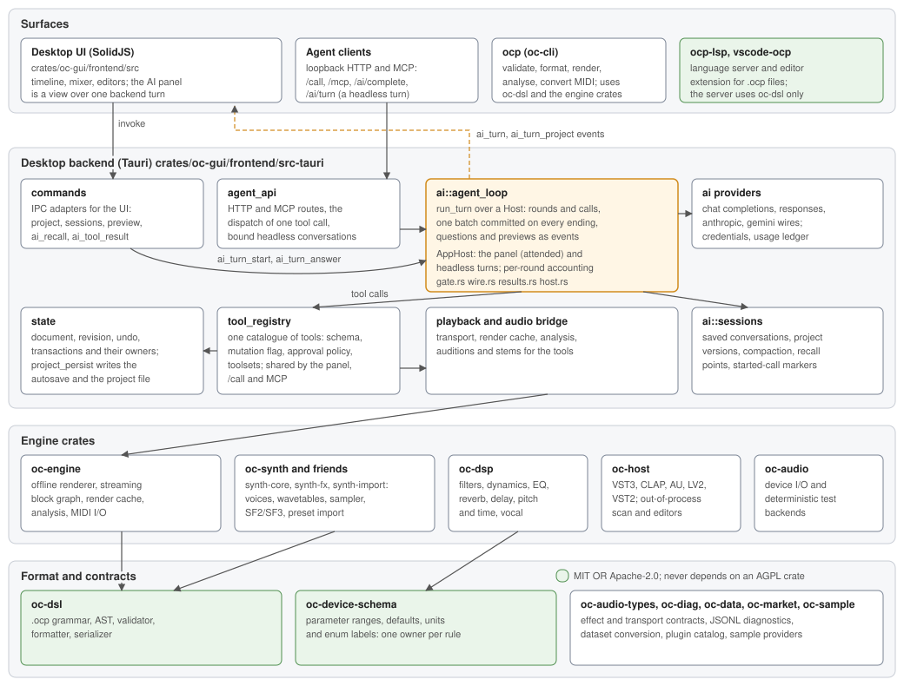

# OpenCompose manual

OpenCompose is a digital audio workstation that stores a song as a text file.
A `.ocp` document lists the tracks, patterns, notes, mixer settings and effects
as readable lines. You can edit that file by hand, have a model generate it,
render it with the command line or play it in the desktop app.

## What you work with

The DSL is the `.ocp` project format, currently version 0.6.0. It is plain text
that you can read and diff in version control, and it does not depend on one
engine. See [The .ocp file](dsl.md).

The `ocp` CLI parses, validates, formats, exports and renders a project. It
also analyses audio and converts MIDI. See [Command line](cli.md).

The GUI is the Tauri desktop app. It has a timeline, piano roll, mixer, device
rack, patch editor, plugin browser, DSL sidebar and AI panel. See
[The window](gui.md).

The running GUI also exposes an MCP and HTTP agent API, described in
[Drawing from an agent](agents.md).

## How the code fits together

The desktop UI and agent clients call the same backend. The AI panel and a
headless `POST /ai/turn` both run the one agent loop in the backend. The panel
draws the loop's events and passes on your answers to its questions. The format
crates at the bottom of the diagram are permissively licensed, so editors and
other tools can depend on them.

## Chapters

1. [Getting started](getting-started.md): build the CLI and the GUI, open the
   sample project, and try five first steps.
2. [The .ocp file](dsl.md): the language. Song, sections, patterns, clips,
   notes, hits, automation, presets, tracks, buses, master, effects and audio
   clips.
3. [Command line](cli.md): every `ocp` subcommand with an example.
4. [The window](gui.md): transport, timeline, piano roll, mixer, device rack,
   patch editor, plugin browser, DSL editor, AI panel, diagnostics and
   shortcuts.
5. [Built-in devices](devices.md): the mixer device reference. What each device
   does, its controls, and when to use it.
6. [OpenSynth](synth.md): the built-in synthesizer. Oscillators, warp, unison,
   filters, envelopes, LFOs, mod matrix, FX rack and preset import.
7. [Drawing from an agent](agents.md): what the agent API can do, what a
   transaction guarantees, and the limits of the AI panel.
8. [Plugins](plugins.md): which plugin formats are hosted, how a project
   addresses a plugin, and what the free-plugin catalog contains.
9. [Troubleshooting](troubleshooting.md): the failures users report, and how
   to collect a diagnostic bundle.

## Conventions

- Paths are relative to the repository root.
- **Mod** means Cmd on macOS and Ctrl on Windows and Linux.
- Track, bus and preset names are case-sensitive. The name is the routing
  identity.
- Bar and beat positions start at 1. The end of a range is exclusive.
- The chapters describe the product as it behaves now. Design rationale,
  measurements and open questions are in the design documents listed in
  [the documentation map](../README.md), and each chapter links to the ones it
  depends on.

## Where the design lives

- [Audio clips](../audio-clip.md) and [time-stretch](../audio-clip-stretch.md)
- [Mixer routing](../mixer-routing.md)
- [Modulation](../modulation.md) and [filter character](../filter-character.md)
- [Drum kits](../drum-kit.md), [swing](../timing.md#swing) and
  [arrangement](../arrangement.md)
- [Devices](../eq-editor.md), [vocal chain](../vocal-chain.md),
  [limiter](../limiter.md) and [multiband](../multiband.md)
- [MIDI import/export](../midi-import-export.md) and [live MIDI](../midi-live.md)
- [AudioUnit hosting](../au-hosting.md): which AU components render offline and
  which stay scan-only
- [Agent feedback loop](../agent-loop.md)
- [Compatibility and originality](../compatibility.md): the compatibility scope
  and the originality rules
